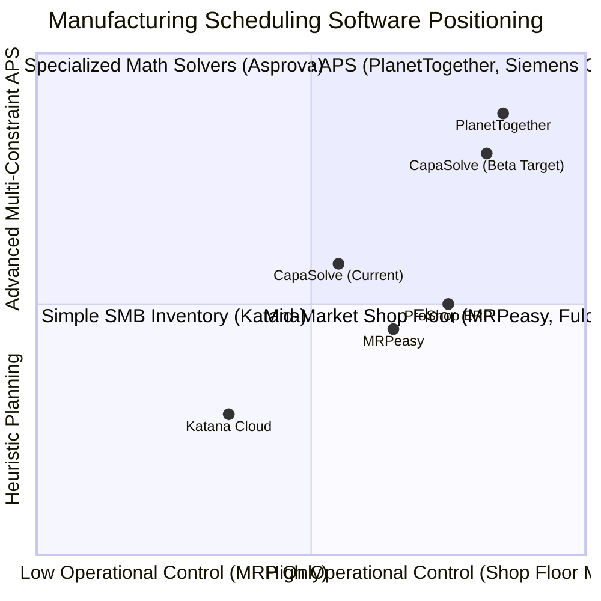
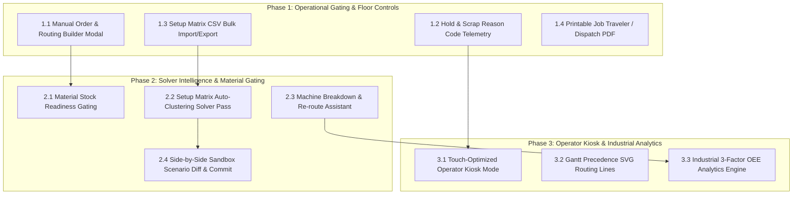

# CapaSolve / MFG Scheduler — Flagship Product Architecture & Commercial Beta-Readiness Blueprint

## Executive Vision & Role Perspective

As **Lead Software Engineer & Head of Product**, this blueprint establishes the technical and functional transformation of **CapaSolve / MFG Scheduler** into a commercial-grade, multi-tenant Advanced Planning & Scheduling (APS) and Shop Floor Operations (MES) SaaS. 

This document provides a concrete, non-surface-level architectural breakdown of:
1. **Current System State & Inventory** (Data structures, algorithms, routes, state management).
2. **Exhaustive Tab-by-Tab & Feature-by-Feature Gap Analysis** (Tabs 1 to 10).
3. **Competitor Benchmark & Gap Analysis** (Benchmarked against *Katana Cloud Manufacturing*, *MRPeasy*, *PlanetTogether APS*, and *ProShop ERP*).
4. **What We Are Missing: The 7 Core Architectural Deficits**.
5. **Phased Engineering & Product Implementation Plan** to achieve commercial Beta readiness.
6. **Verification & Testing Plan**.

---

## User Review Required

> [!IMPORTANT]
> **Key Architectural Decisions for Beta Launch:**
> 1. **Material Readiness Gate:** Should the scheduler strictly **block** work orders from being dispatched if required raw materials are out of stock (like Katana), or display a soft **"Material Warning"** badge allowing the planner to override? *(Default: Soft warning with planner override).*
> 2. **Setup Matrix Auto-Clustering Strategy:** When the finite capacity solver runs, should it prioritize **Earliest Due Date (EDD)** or **Minimum Changeover Waste (Setup Matrix clustering)**? *(Default: Hybrid Mode — clusters compatible materials within a 3-day window, then obeys due date constraints).*
> 3. **Operator Kiosk Mode:** Should the dedicated shop floor touch view exist as a distinct route (`/kiosk`) or a simplified toggle mode on the `/status` page? *(Default: Dedicated `/kiosk` route with workstation PIN/lock for shop floor tablets).*

---

## 1. Current State Inventory: What We Have Built

Our application is built on **React 19 + TanStack Router + Vite + Zustand + Tailwind CSS + Lucide Icons**. It features serverless REST API endpoints for external ERP connectivity (`POST /api/v1/schedule/solve`, `GET/POST /api/v1/orders`), Supabase cloud persistence, and a custom finite capacity heuristics engine.

### Current Data Models & Types (`src/lib/types.ts`)
* **`Order`**: Tracks `id`, `orderId` (WO number), `material`, `sopStartDate`, `sopStartTime`, `orderQty`, `priority` (`Urgent` | `High` | `Med` | `Low`).
* **`OrderProcess`**: Routing step tracking `id`, `orderId`, `processId` (step 10, 20...), `machineId`, `processText`, `setupTimeMin` (R), `processTimeMin` (M), `manpowerUtilizationMin`, `sumV2`, `sumV3`, `totalTimeMin`, `status` (`SCHEDULED` | `UNSCHEDULED`), `scheduledStart`, `scheduledEnd`, `isManual`, `executionStatus` (`QUEUED` | `PLANNED` | `IN_PROGRESS` | `PAUSED` | `COMPLETED` | `DELAYED`), `completedQty`, `scrapQty`.
* **`Machine` & `MachineGroup`**: Machine ID, Name, and Group ID (`M1`, `M2`, `CNC`, etc.).
* **`ScheduleSlot`**: Hourly allocation slots with shift assignment (Shift 1: 06:00–13:00, Shift 2: 13:00–20:00).
* **`SetupMatrixRule`**: Sequence changeover rules (`fromMaterial`, `toMaterial`, `setupTimeMin`).
* **`MaterialInventoryItem`**: Basic inventory balance tracking in modal.

### Route-by-Route Current Capability Matrix

| Route / Tab | Current Built Capabilities | Limitations in Current Codebase |
| :--- | :--- | :--- |
| **`/dashboard`** | 4 primary KPI cards, Execution Status Strip (`Queued`, `Hold`, `Released`, `Running`, `Done`), Dispatch & WIP Table with 1-click status actions, Data Cleaning Assistant, CSV uploader. | Lacks OEE summary, plant bottleneck alert, machine department filtering, and printable traveler PDF. |
| **`/orders`** | Order table with COOIS fields, process step sub-tables, Excel spreadsheet view, CSV/TSV parser, data cleaner with auto-repair. | Cannot create or edit orders manually in the UI; no customer delivery deadline vs SOP date separation; no material readiness indicator. |
| **`/gantt`** | Machine swimlanes, Day/Week/Month views, working hours (06:00–20:00), setup (R) vs process (M) blocks, slide-over drawer with sticky footer & execution buttons. | No native drag-and-drop on the timeline bars; no visual routing precedence bezier curves (Step 10 $\rightarrow$ 20 $\rightarrow$ 30); no non-working hour dimming. |
| **`/status`** | Production Schedule Calendar, live execution counter pills, workstation swimlanes, machine filtering. | No touch-friendly Operator Kiosk view; no hold/pause reason codes; no actual vs scheduled cycle time logging. |
| **`/capacity`** | Daily capacity limits, setter/operator capacity ceilings, capacity override inputs, Recharts utilization curves, process step drawer. | Purely reactive charts; no dual-resource solving (machine + operator simultaneity); no visual scheduled maintenance blocks. |
| **`/sandbox`** | What-if scenario parameters (prepone weeks, overtime, setup matrix rules), scenario runner. | No side-by-side scenario comparison matrix; no 1-click "Commit Scenario to Live Schedule" action. |
| **`/monthly`** | Monthly workload distribution, strategy toggles, high-level heatmap. | Lacks Rough-Cut Capacity Planning (RCCP) metrics and monthly over-capacity alert thresholds. |
| **`/machines` & `/shifts`** | Workstation cards, machine groups, Shift 1 & 2 definitions, Breakdown Re-routing Assistant. | Machine hourly cost rates and multi-shift overtime calendars. |
| **`/analytics`** | Standard 3-factor OEE ($A \times P \times Q$) scorecard, Availability/Performance/Quality pillars, machine capacity load, Changeover Waste leaderboard, Scrap Defect Pareto chart, group filtering, and live floor simulation controls. | Dynamic scrap costing per material family; long-horizon MTBF/MTTR trends. |
| **`/settings`** | Setup Matrix rule builder with CSV Import/Export, organization profile, Supabase sync, RBAC permissions. | Offline JSON/ZIP export backup. |

---

## 2. Exhaustive Tab-by-Tab & Feature-by-Feature Gap Analysis

### Tab 1: Executive Overview & Shop Floor Dispatch (`/dashboard`)
* **Current Status:** 4 primary KPI cards (Orders, Processes, Machines, Scheduled Processes), Interactive Status Pills Strip (`Queued`, `Hold`, `Released`, `Running`, `Done`), live dispatch table with 1-click execution actions (`Start`, `Hold`, `Done`, `Resume`), Data Cleaning Assistant, and CSV uploader.
* **What is Missing / Gaps for Beta-Ready:**
  * **Factory Velocity & OTD (On-Time Delivery) Projection:** Planners need a headline gauge: *"Projected On-Time Delivery: 94.2%"* based on active schedules vs customer delivery deadlines.
  * **Active Bottleneck Indicator:** An alert widget showing the critical bottleneck workstation (e.g., *"Workstation CNC-603011 is at 118% capacity — 4 orders delayed"*).
  * **Workstation / Department Quick Filter on Dispatch Queue:** Floor managers oversee specific departments (Milling, Turning, Assembly). Adding a machine filter dropdown directly above the dispatch table allows a supervisor to filter instantly to their line's queue.
  * **Shift Handover Digest / Exportable Traveler:** 1-click button to export/print the daily dispatch queue as a **Job Traveler / Shift Handover PDF**.

### Tab 2: Work Orders & COOIS Data Management (`/orders`)
* **Current Status:** Order grid with SAP COOIS fields (Order ID, Material, SOP Date/Time, Qty, Priority), process step breakdowns, CSV/TSV data cleaning hub, Excel spreadsheet view tab.
* **What is Missing / Gaps for Beta-Ready:**
  * **Order Due Date vs SOP Start Date Separation:** Differentiating the **Customer Delivery Deadline** from the **Production Start Date (SOP)**. When orders run late, the system should flag the exact lateness in hours/days.
  * **Material Readiness Gating:** In Katana, orders have an "Ingredients / Material: Ready" pill. If raw material is not in inventory, the order should display a yellow *"Material Pending"* warning, preventing floor dispatch until released.
  * **Manual Order Creation & Routing Modal:** Currently, orders must be uploaded via CSV. For real shop floors, planners need a **"+ New Work Order"** modal to manually input an urgent job, define steps (10 Cut $\rightarrow$ 20 Mill $\rightarrow$ 30 Coat), and inject it into the active schedule.
  * **Order Priority Level Override:** Bulk action to set selected orders to *Urgent / High / Normal / Low* with instant visual tag updating.

### Tab 3: Visual Workstation Gantt Sequencer (`/gantt`)
* **Current Status:** Machine swimlanes, Day/Week/Month granularity, working hours (06:00–20:00), setup (R) vs process (M) blocks, slide-over drawer with sticky footer & execution buttons.
* **What is Missing / Gaps for Beta-Ready:**
  * **Direct Drag-and-Drop Gantt Rescheduling:** While manual hour/machine input works in the right drawer, planners expect to click and drag an operation bar directly to another hour or machine lane with collision snap.
  * **Routing Precedence Arrows / Link Curves:** Showing visual bezier curves connecting Step 10 $\rightarrow$ Step 20 $\rightarrow$ Step 30 across machines so planners instantly spot if Step 20 is scheduled before Step 10 completes (routing violation).
  * **Multi-Shift Visual Overlays & Non-Working Hours Dimming:** Clearly graying out non-working hours and scheduled downtime on the timeline so users immediately see why gaps exist.
  * **Andon Big-Screen Display Mode:** A button to toggle full-screen kiosk view with auto-refresh every 60 seconds for shop floor wall monitors.

### Tab 4: Production Schedule & Execution Calendar (`/status`)
* **Current Status:** Calendar timeline, status filter strip, swimlane views, step details.
* **What is Missing / Gaps for Beta-Ready:**
  * **Digital Operator Kiosk Mode (Touch View):** A dedicated, simplified screen layout designed for shop floor touchscreens:
    - Large "SCAN / SELECT JOB" input
    - Huge **START**, **PAUSE / HOLD**, **LOG SCRAP**, and **COMPLETE** buttons.
  * **Scrap & Downtime Reason Codes:** When an operator places an operation on "Hold" or logs scrap, a quick dropdown modal should prompt:
    - *Hold Reasons:* Machine Breakdown, Waiting for Tooling, Material Defect, Operator Shift Change.
    - *Scrap Reasons:* Setup Scrap, Dimension Out of Spec, Surface Flaw.
  * **Operator Efficiency & Actual vs Planned Time:** Tracking actual elapsed time vs planned cycle time to highlight if a job took 120 minutes instead of the scheduled 90 minutes.

### Tab 5: Workstation & Labor Capacity Planner (`/capacity`)
* **Current Status:** Setter & Operator capacity thresholds, daily overrides, Recharts utilization curves.
* **What is Missing / Gaps for Beta-Ready:**
  * **Dual-Constraint Verification (Machine + Labor):** True finite capacity scheduling requires checking both: *Is Machine 603011 free?* AND *Is a certified Setter / Operator available at that exact hour?*
  * **Visual Maintenance Windows:** Direct integration with scheduled machine maintenance so downtime appears as red hatched unavailable blocks on the capacity chart.
  * **Capacity Utilization Heatmap by Machine Group:** Quick color-coded table (Green <80%, Amber 80–100%, Red >100%) for 4-week lookahead.

### Tab 6: What-If Scenario Lab (`/sandbox`)
* **Current Status:** Parameter adjustments (overtime, prepone weeks, overlap, setup rules), scenario runner.
* **What is Missing / Gaps for Beta-Ready:**
  * **Side-by-Side Scenario Comparison Card:** Comparing *Scenario A (Baseline)* vs *Scenario B (Overtime Added)* vs *Scenario C (Setup Clustering)*:
    - Total Production Days (Makespan)
    - Total Setup Hours Saved
    - On-Time Completion Rate %
    - Labor Overtime Cost Estimate
  * **"Commit to Live Production" Action:** When a planner finds the optimal scenario in the Sandbox, a 1-click button to overwrite the live production schedule with the simulated plan.

### Tab 7: Long-Horizon S&OP Monthly Planner (`/monthly`)
* **Current Status:** Monthly calendar distribution, optimization mode toggles, workload aggregation.
* **What is Missing / Gaps for Beta-Ready:**
  * **Rough-Cut Capacity Planning (RCCP) Summary:** Aggregating total monthly demand hours vs total available shift hours per machine group.
  * **Capacity Overbooking Warnings:** Visual alert when a future month exceeds 100% capacity before detailed hourly scheduling.

### Tab 8: Assets, Workstations & Shifts (`/machines` & `/shifts`)
* **Current Status:** Machine cards, machine groups (M1, M2), Shift 1 & 2 definitions.
* **What is Missing / Gaps for Beta-Ready:**
  * **Machine Breakdown / Out-of-Order Toggle:** Clicking "Mark Out of Order" prompts: *"Machine CNC-01 is down. 6 scheduled operations affected. Re-route to Machine CNC-02?"*
  * **Custom Multi-Shift & Weekend Calendars:** Allowing 3-shift 24/7 schedules or weekend overtime on a per-machine basis.
  * **Hourly Machine Operating Cost Rate:** Field for cost per hour (e.g. $85/hr) to calculate production costing.

### Tab 9: Analytics & Performance Intelligence (`/analytics`)
* **Current Status:** 3-factor industrial OEE scorecard ($A \times P \times Q$), Availability, Performance, and Quality pillar gauges with baseline/live execution indicators, group-filtered capacity utilization cards, Workstation Time Allocation breakdown, Bottleneck Load Rate analysis, Changeover Waste leaderboard (with setup penalty hours and estimated cost), Scrap Defect Pareto chart, and 1-click Shop Floor Execution simulation controls.
* **What is Missing / Gaps for Beta-Ready:**
  * **Dynamic Scrap Costing:** Linking defect tallies to material raw stock cost rates per SKU.
  * **MTBF / MTTR Reliability Telemetry:** Tracking Mean Time Between Failures and Mean Time to Repair for preventive maintenance.

### Tab 10: Settings, Setup Matrix & Multi-Tenancy (`/settings`)
* **Current Status:** Setup matrix rules (From Material -> To Material), organization profile, Supabase sync.
* **What is Missing / Gaps for Beta-Ready:**
  * **Setup Matrix CSV Import/Export:** In precision machining or injection molding, setup matrices have 50–500 rows. Planners must be able to upload a CSV matrix table.
  * **Role-Based Access Control (RBAC) Enforcement in UI:** Clear UI differences between:
    - **Admin / Planner:** Full schedule generation, parameter overrides, matrix edits.
    - **Shop Floor Supervisor:** Dispatching, holding, rescheduling within shift.
    - **Operator:** View-only assigned workstation, log units and scrap.
  * **Export Full System Backup (JSON/ZIP):** Offline backup and restore for compliance.

---

## 3. Competitor Benchmark & Gap Analysis

To compete directly with established solutions, we benchmark against 4 market leaders:

### 1. Katana Cloud Manufacturing Benchmark
* **What Katana Does Well:** Extreme UI simplicity; automated material commitment ("Ingredients: IN STOCK" vs "EXPECTED"); drag-and-drop job priority re-ordering.
* **Where CapaSolve is Better:** CapaSolve has finite capacity machine swimlanes, setup time vs process time tracking (SumV2/SumV3), and sequence-dependent setup matrices, which Katana lacks.
* **Our Critical Gap:** CapaSolve does not link material inventory availability to work order dispatch. A job can be scheduled even if raw bar stock is 0.

### 2. MRPeasy Benchmark
* **What MRPeasy Does Well:** Shop floor reporting kiosk for tablets; scrap reporting with reason codes; maintenance schedules integrated into calendar; dynamic lead time estimations.
* **Where CapaSolve is Better:** Modern, reactive, lightning-fast UI (built on React 19 + Tailwind); integrated What-If Scenario Lab (`/sandbox`); superior high-mix data cleaning hub.
* **Our Critical Gap:** Lack of a dedicated operator tablet kiosk and lack of scrap/hold reason code telemetry.

### 3. PlanetTogether APS Benchmark
* **What PlanetTogether Does Well:** Multi-constraint finite capacity optimization; automated Setup Matrix sequence clustering (grouping stainless steel together to eliminate changeover downtime); side-by-side scenario comparison diffs.
* **Where CapaSolve is Better:** Modern cloud-native stack, instant browser performance, zero installation overhead, transparent setup matrix editor.
* **Our Critical Gap:** Our solver sequences by priority and SOP start date, but does not yet run a sequence clustering pass to minimize changeovers dynamically.

---

## 4. What We Are Missing: The 7 Core Architectural Deficits

To transform this codebase into an enterprise-ready flagship product, we must resolve 7 fundamental gaps:

### Deficit 1: Closed-Loop Execution & Reason Code Telemetry
* **Problem:** Operators can click "Hold" or "Done", but cannot capture **why** an operation stopped (e.g. Broken insert, waiting on material, inspection hold) or record scrap pieces with defect categories.
* **Requirement:** Quick modal dialogs on "Hold" and "Log Scrap" capturing structured reason codes and operator notes, feeding into quality analytics.

### Deficit 2: Material Availability Gating (BOM Linkage)
* **Problem:** The active orders list assumes infinite raw materials. If material `100-024-830.01-00` has 0 inventory, the job still dispatches to the floor.
* **Requirement:** Order-level Material Readiness status (`READY`, `LOW_STOCK`, `SHORTAGE`) with automatic inventory consumption calculation upon order completion.

### Deficit 3: Manual Work Order & Multi-Step Routing Builder
* **Problem:** Users can only import orders via CSV upload. If an urgent repair job or prototype order comes in, the plant manager cannot create it in the UI.
* **Requirement:** An interactive **"+ Create Work Order"** modal with multi-step routing builder (Step 10 -> Step 20 -> Step 30, assigned machines, setup/run times).

### Deficit 4: Setup Matrix Auto-Clustering Optimization in Solver
* **Problem:** The Setup Matrix exists in settings, but the scheduling solver primarily sequences by `priority` and `sopStartDate`.
* **Requirement:** An optimization pass in `scheduler.ts` that groups jobs requiring identical tooling or material within a configurable tolerance window, reducing total plant setup hours by 15–30%.

### Deficit 5: Drag-and-Drop & Visual Precedence Routing on Gantt
* **Problem:** Planners cannot drag blocks directly on the Gantt timeline, and cannot see routing precedence lines connecting Step 10 to Step 20.
* **Requirement:** Visual SVG precedence arrows between order steps, and intuitive drag-and-drop block repositioning with collision warning feedback.

### Deficit 6: Machine Downtime & Instant Re-routing Engine
* **Problem:** When a CNC machine breaks down, planners have to manually find every slot and reschedule it one-by-one.
* **Requirement:** A "Mark Machine Down" action on `/machines` that flags all scheduled operations and offers a 1-click dialog: *"Re-route 5 affected operations to compatible Machine 603012"*.

### Deficit 7: True OEE & Changeover Cost Intelligence (`/analytics`)
* **Built Status:** Full 3-factor industrial OEE ($A \times P \times Q$) scorecard implemented with real-time Availability (uptime vs downtime), Performance (planned standard vs speed rate), and Quality (Good vs Scrap units). Includes Changeover Waste Leaderboard, Defect Pareto analysis, and Machine Group filtering.
* **Next Frontier:** Dynamic scrap financial costing based on per-part raw material cost matrices and shop floor MTBF reliability telemetry.

---

## 5. Proposed Implementation Plan

The roadmap is structured into **3 concrete implementation phases**:

---

### Detailed Engineering Specifications

#### Phase 1: Operational Gating & Floor Controls (Immediate Beta Blockers)

##### 1.1 Manual Order & Multi-Step Routing Builder Modal
* **Target File:** [src/components/modals/CreateWorkOrderModal.tsx](file:///d:/schedulersaas/flow-sync-saas/src/components/modals/CreateWorkOrderModal.tsx) (NEW) & [src/routes/orders.tsx](file:///d:/schedulersaas/flow-sync-saas/src/routes/orders.tsx)
* **Design:**
  - Responsive modal with 2 tabs: **Basic Info** (Order Number, Material SKU, Target Qty, Priority, Due Date) and **Process Routing** (interactive list of steps).
  - Add Step button: allows defining Step # (10, 20, 30), Operation Text (e.g. "CNC Milling"), Machine selection from active machine list, Setup minutes (R), and Cycle minutes (M).
  - Validates sequence numbers and calculates total expected cycle time.
  - Injects new `Order` and `OrderProcess[]` into Zustand store and runs the finite capacity scheduler automatically.

##### 1.2 Hold & Scrap Reason Code Modals
* **Target Files:** [src/components/modals/HoldReasonModal.tsx](file:///d:/schedulersaas/flow-sync-saas/src/components/modals/HoldReasonModal.tsx) (NEW), [src/components/modals/LogScrapModal.tsx](file:///d:/schedulersaas/flow-sync-saas/src/components/modals/LogScrapModal.tsx) (NEW), [src/routes/dashboard.tsx](file:///d:/schedulersaas/flow-sync-saas/src/routes/dashboard.tsx), [src/components/GanttTimelineView.tsx](file:///d:/schedulersaas/flow-sync-saas/src/components/GanttTimelineView.tsx)
* **Design:**
  - When clicking "Hold", display a dialog with preset categories:
    - `TOOLING_ISSUE` (Worn tool, tool changeover)
    - `MACHINE_FAULT` (Spindle error, coolant leak)
    - `MATERIAL_DEFECT` (Dimensions out of spec, hardness issue)
    - `OPERATOR_PAUSE` (Shift change, break)
    - `QUALITY_CHECK` (First article inspection)
  - When logging scrap, capture scrap quantity and defect reason code.
  - Updates `OrderProcess` with `operatorNotes`, `scrapReason`, and `holdReason`.

##### 1.3 Setup Matrix CSV Bulk Import / Export
* **Target File:** [src/routes/settings.tsx](file:///d:/schedulersaas/flow-sync-saas/src/routes/settings.tsx)
* **Design:**
  - Add "Export Setup Matrix (CSV)" and "Import Setup Matrix (CSV)" buttons.
  - Parse CSV format: `fromMaterial,toMaterial,machineGroupId,setupTimeMin,description`.
  - Includes sample template download and validation for missing material codes.

##### 1.4 Printable Job Traveler & Daily Dispatch PDF
* **Target File:** [src/components/JobTravelerSheet.tsx](file:///d:/schedulersaas/flow-sync-saas/src/components/JobTravelerSheet.tsx) (NEW) & [src/routes/dashboard.tsx](file:///d:/schedulersaas/flow-sync-saas/src/routes/dashboard.tsx)
* **Design:**
  - Print-optimized CSS stylesheet (`@media print`) rendering a standard manufacturing **Shop Floor Job Traveler**:
    - Work Order Barcode & Header
    - Customer / Part Specification
    - Sequential Routing Sign-Off Table (Step, Workstation, Scheduled Time, Operator Initials, Inspection Stamp)
    - 1-click browser print dialog (`window.print()`).

---

#### Phase 2: Solver Intelligence & Material Gating

##### 2.1 Material Inventory Stock Readiness Gating
* **Target Files:** [src/lib/types.ts](file:///d:/schedulersaas/flow-sync-saas/src/lib/types.ts), [src/lib/store.ts](file:///d:/schedulersaas/flow-sync-saas/src/lib/store.ts), [src/routes/orders.tsx](file:///d:/schedulersaas/flow-sync-saas/src/routes/orders.tsx)
* **Design:**
  - Cross-reference `Order.material` and `Order.orderQty` with `materialsInventory` store.
  - Add `materialStatus` to enriched order view:
    - `READY` (Green: in-stock qty $\ge$ order qty)
    - `LOW_STOCK` (Amber: stock available for partial run)
    - `SHORTAGE` (Red: zero stock available)
  - Dashboard and Orders table display visual badge.

##### 2.2 Setup Matrix Auto-Clustering Optimization in Solver
* **Target File:** [src/lib/scheduler.ts](file:///d:/schedulersaas/flow-sync-saas/src/lib/scheduler.ts)
* **Design:**
  - Implement heuristic pass in `runFiniteScheduler`:
    1. Group orders with compatible materials on the same machine group within a sliding time horizon (e.g. 72 hours).
    2. Sort sequential orders to minimize transition time via `getSequenceSetupTime`.
    3. Respect priority and deadline buffers.
  - Output metric: `totalSetupMinutesSaved` in `ScheduleResult`.

##### 2.3 Machine Breakdown & Instant Re-routing Assistant
* **Target Files:** [src/routes/machines.tsx](file:///d:/schedulersaas/flow-sync-saas/src/routes/machines.tsx) & [src/lib/store.ts](file:///d:/schedulersaas/flow-sync-saas/src/lib/store.ts)
* **Design:**
  - Add "Report Breakdown / Maintenance" toggle on each machine card.
  - Triggers a smart re-routing dialog:
    - Lists all operations scheduled on that machine during the downtime window.
    - Searches for compatible machines in the same `machineGroupId`.
    - Offers 1-click bulk re-assignment and updates the schedule cleanly.

##### 2.4 What-If Scenario Side-by-Side Diff & Commit
* **Target File:** [src/routes/sandbox.tsx](file:///d:/schedulersaas/flow-sync-saas/src/routes/sandbox.tsx)
* **Design:**
  - Side-by-side comparison table:
    | Metric | Baseline Schedule | What-If Scenario | Delta |
    | :--- | :--- | :--- | :--- |
    | Total Makespan | 14 Days | 11 Days | -3 Days (-21%) |
    | Setup Waste | 42.5 Hours | 28.0 Hours | -14.5 Hours (-34%) |
    | Machine Overtime | 0 Hours | 16 Hours | +16 Hours |
    | On-Time Delivery | 88.5% | 97.2% | +8.7% |
  - "Commit Scenario to Live Production" button with confirmation modal.

---

#### Phase 3: Operator Kiosk & Industrial Analytics

##### 3.1 Touch-Optimized Operator Kiosk Mode (`/kiosk`)
* **Target File:** [src/routes/kiosk.tsx](file:///d:/schedulersaas/flow-sync-saas/src/routes/kiosk.tsx) (NEW)
* **Design:**
  - Full-screen, high-contrast UI tailored for 10"–15" shop floor tablets.
  - Machine selector dropdown (e.g. "Station CNC-01").
  - Shows only the **Current Active Job** and **Next In Queue**.
  - Giant tactile buttons: `START JOB`, `PAUSE / HOLD`, `LOG SCRAP`, `COMPLETE`.
  - Big numerical counter for completed units with rapid `+1`, `+5`, `+10` buttons.

##### 3.2 Gantt Precedence Routing SVG Lines (`/gantt`)
* **Target File:** [src/components/GanttTimelineView.tsx](file:///d:/schedulersaas/flow-sync-saas/src/components/GanttTimelineView.tsx)
* **Design:**
  - Render dynamic SVG curved bezier lines connecting sequential steps of the selected order (Step 10 on Machine A $\rightarrow$ Step 20 on Machine B).
  - Highlights sequence in bright primary color; warns in red if Step 20 starts before Step 10 finishes.

##### 3.3 Industrial 3-Factor OEE Analytics Engine (`/analytics`)
* **Target File:** [src/routes/analytics.tsx](file:///d:/schedulersaas/flow-sync-saas/src/routes/analytics.tsx)
* **Design:**
  - Full OEE Gauge Card:
    $$\text{OEE} = \text{Availability (92%)} \times \text{Performance (95%)} \times \text{Quality (98.5%)} = 86.1\%$$
  - Setup Waste Leaderboard: identifies materials causing the highest changeover delays.
  - Scrap cost estimation based on scrap pieces and base unit cost.

---

## 6. Verification & Testing Plan

### Automated Test Suites
1. **Solver Optimization Tests (`src/lib/__tests__/scheduler.test.ts`)**:
   - Verify setup matrix auto-clustering reduces total setup minutes compared to unsorted baseline.
   - Verify precedence constraints: Step $N+1$ never schedules before Step $N$ completes.
   - Verify machine breakdown re-routing re-assigns only to compatible machines.
2. **Store & State Transitions (`src/lib/__tests__/store.test.ts`)**:
   - Test manual order creation, step additions, and store synchronization.
   - Test hold reason codes, scrap logging, and inventory quantity decrements.
   - Test scenario commit functionality overwriting live store state cleanly.
3. **Type & Compilation Check**:
   - Run `npx tsc --noEmit` across all modified and new files (0 errors target).
   - Run `npm run test` ensuring 100% pass rate.

### Manual & Visual Verification
1. **Interactive Manual Order Creation**: Create an order directly in `/orders`, verify it appears in the Gantt sequencer and Dashboard dispatch table.
2. **Shop Floor Execution Flow**: From the Dashboard and Drawer, set operations to Hold, log scrap, verify reason code badges display properly.
3. **Printable Job Traveler**: Trigger "Print Traveler", verify cleanly formatted layout without UI chrome.
4. **Side-by-Side Sandbox Comparison**: Modify parameters in `/sandbox`, verify side-by-side metric comparison, test "Commit to Live" button.

---

## Conclusion & Next Step

This plan elevates CapaSolve from a competent proof-of-concept into a **flagship, industry-competitive manufacturing scheduling and execution platform**. 

Upon user review and approval of this plan, execution will commence immediately with **Phase 1: Operational Gating & Floor Controls**.
