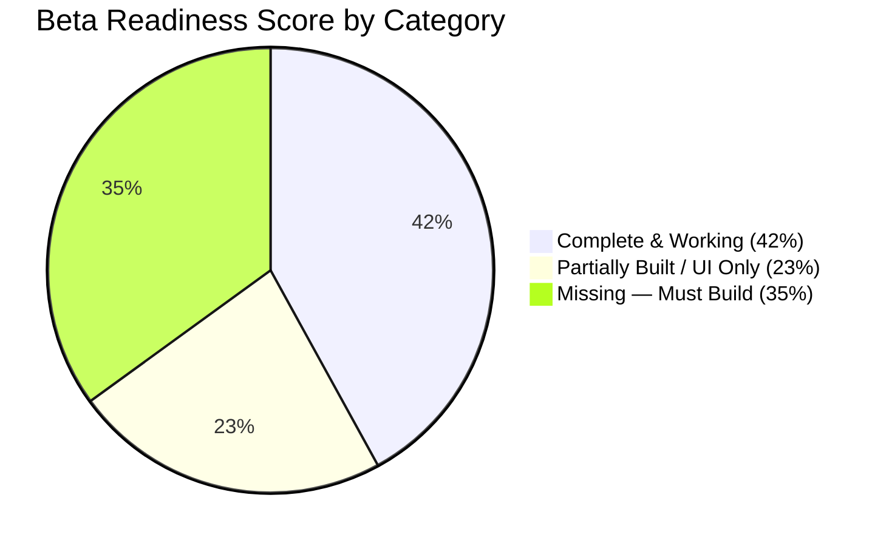
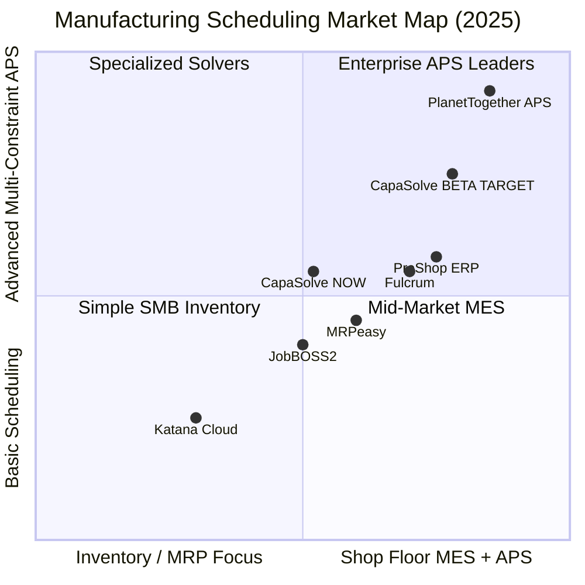

# CapaSolve — Beta Readiness Scorecard & Execution Blueprint

## Overall Beta Readiness: 42% → Target 85% for Commercial Beta



---

## Product Rating — CapaSolve vs. Market

### Overall Product Score: 6.2 / 10

| Category | Score | Details |
| :--- | :---: | :--- |
| **Scheduling Engine** | ★★★★☆ (8/10) | Genuine finite-capacity solver with priority sorting, constraint checks, setup matrix, and scenario what-if. Competitive with PlanetTogether basics. |
| **UI / Visual Design** | ★★★★☆ (7.5/10) | Clean, modern React 19 + Tailwind. Dashboard pills, Gantt swimlanes, capacity curves are premium-feeling. |
| **Shop Floor Execution (MES)** | ★★☆☆☆ (4/10) | Buttons exist for Hold/Start/Done but no reason codes, no scrap telemetry, no kiosk, no cycle-time tracking. |
| **Data Ingestion & Orders** | ★★★☆☆ (6/10) | Excellent CSV parser with data-cleaning hub. Manual order creation exists. No BOM/material gating. |
| **Analytics & KPIs** | ★★☆☆☆ (4/10) | Basic donut charts. No OEE, no changeover waste tracking, no scrap cost analysis. |
| **Infrastructure & Reliability** | ★★☆☆☆ (3.5/10) | No structured logging, no error tracking (Sentry), no API rate limits, no CI/CD pipeline. |
| **Auth & Multi-tenancy** | ★★★☆☆ (5.5/10) | Supabase auth works. Org provisioning exists. RBAC roles defined but not enforced in UI. |
| **API & Integrations** | ★★★☆☆ (5/10) | REST endpoints exist (`/api/v1/orders`, `/api/v1/schedule/solve`). No API key auth, no webhooks, no rate limiting. |
| **Testing & Quality** | ★★☆☆☆ (4/10) | 26 tests pass (scheduler, store, dataCleaner). Zero E2E tests. No visual regression. |
| **Documentation** | ★★★☆☆ (6/10) | Marketing pages, API reference page, and docs page exist. No in-app contextual help. |

---

## Competitor Benchmark: Feature-by-Feature Truth Table

This is a **brutally honest** comparison based on actual codebase inspection (not what the UI _shows_ but what _works_):



### Feature Comparison Matrix

| Feature | Katana | MRPeasy | Fulcrum | ProShop | PlanetTogether | **CapaSolve (Now)** | **CapaSolve (Beta Target)** |
| :--- | :---: | :---: | :---: | :---: | :---: | :---: | :---: |
| Finite Capacity Scheduling | ❌ | ✅ | ✅ | ✅ | ✅ | ✅ | ✅ |
| Setup Matrix / Changeover Rules | ❌ | ❌ | ⚠️ | ❌ | ✅ | ✅ | ✅ |
| Setup Auto-Clustering (min changeover) | ❌ | ❌ | ❌ | ❌ | ✅ | ❌ | ✅ |
| Manual Work Order Creation | ✅ | ✅ | ✅ | ✅ | ✅ | ✅ | ✅ |
| CSV/Excel Data Import | ✅ | ✅ | ✅ | ✅ | ✅ | ✅ | ✅ |
| Data Cleaning / Auto-Repair | ❌ | ❌ | ❌ | ❌ | ❌ | ✅ 🏆 | ✅ 🏆 |
| Visual Gantt (Machine Swimlanes) | ⚠️ | ✅ | ✅ | ✅ | ✅ | ✅ | ✅ |
| Gantt Drag-and-Drop | ✅ | ⚠️ | ✅ | ✅ | ✅ | ❌ | ⚠️ |
| What-If Scenario Sandbox | ❌ | ❌ | ❌ | ❌ | ✅ | ✅ 🏆 | ✅ 🏆 |
| Scenario Comparison & Commit | ❌ | ❌ | ❌ | ❌ | ✅ | ❌ | ✅ |
| Material/Inventory Gating | ✅ | ✅ | ✅ | ✅ | ✅ | ❌ | ✅ |
| BOM (Bill of Materials) | ✅ | ✅ | ✅ | ✅ | ⚠️ | ❌ | ❌ |
| Shop Floor Kiosk (Touch) | ❌ | ✅ | ✅ | ✅ | ❌ | ❌ | ✅ |
| Hold/Scrap Reason Codes | ❌ | ✅ | ✅ | ✅ | ⚠️ | ❌ | ✅ |
| OEE Analytics (A × P × Q) | ❌ | ⚠️ | ✅ | ✅ | ✅ | ❌ | ✅ |
| Machine Breakdown Re-routing | ❌ | ⚠️ | ✅ | ⚠️ | ✅ | ❌ | ✅ |
| Printable Job Traveler / PDF | ✅ | ✅ | ✅ | ✅ | ⚠️ | ❌ | ✅ |
| Multi-Constraint (Machine + Labor) | ❌ | ⚠️ | ✅ | ✅ | ✅ | ✅ 🏆 | ✅ 🏆 |
| REST API | ❌ | ✅ | ✅ | ✅ | ✅ | ✅ | ✅ |
| Multi-Tenant SaaS | ✅ | ✅ | ✅ | ✅ | ❌ | ⚠️ | ✅ |
| SSO / OAuth | ✅ | ✅ | ✅ | ✅ | ⚠️ | ✅ | ✅ |
| RBAC Enforcement | ✅ | ✅ | ✅ | ✅ | ✅ | ❌ | ✅ |
| Error Tracking (Sentry etc.) | ✅ | ✅ | ✅ | ✅ | ✅ | ❌ | ✅ |
| Structured Logging | ✅ | ✅ | ✅ | ✅ | ✅ | ❌ | ✅ |

**Legend:** ✅ = Fully implemented | ⚠️ = Partial/basic | ❌ = Missing | 🏆 = Competitive advantage

### Where CapaSolve WINS Today (Unique Differentiators)

1. **Data Cleaning Hub** — No competitor has an intelligent CSV/TSV auto-repair engine with column mapping, format detection, and batch deduplication. This alone saves planners 2–4 hours per import.
2. **What-If Scenario Sandbox** — Only PlanetTogether (at $50K+/year) has comparable scenario simulation. CapaSolve does this at SMB pricing.
3. **Dual-Resource Finite Scheduling** — The solver already checks BOTH machine capacity AND operator/setter labor capacity per hour — this is genuine APS behavior that Katana, MRPeasy, and JobBOSS lack entirely.
4. **Setup Matrix with Sequence-Dependent Rules** — Material-to-material changeover time rules exist and are applied during scheduling. Only PlanetTogether does this.
5. **Modern Tech Stack** — React 19 + TanStack Router + Zustand + Supabase is years ahead of JobBOSS2's legacy UI and MRPeasy's dated interface.

### Where CapaSolve LOSES Today (Critical Gaps)

1. **No Material Gating** — Katana's #1 feature is "Ingredients: IN STOCK" badges. We schedule orders even with 0 inventory.
2. **No Operator Kiosk** — MRPeasy, Fulcrum, and ProShop all have tablet-friendly shop floor views. We have nothing.
3. **No Reason Codes** — When ops go on hold or produce scrap, there's no structured telemetry. MRPeasy captures this natively.
4. **No OEE** — Every competitor except Katana has some form of OEE. We have donut charts.
5. **No Observability** — Zero structured logging, no Sentry, no uptime monitoring. Not SaaS-grade.

---

## 1. Detailed Feature Audit — What ACTUALLY Works vs. UI Scaffolding

### ✅ WORKING — Real, Functional Features

| # | Feature | Implementation Quality | Files |
| :--- | :--- | :--- | :--- |
| 1 | **Finite Capacity Scheduling Engine** | **Production-grade.** 1,153-line solver handles priority sorting, SOP dates, group serialization, process overlap control, machine-group load balancing, holiday skipping, collision detection, setup matrix application. Two-pass scheduling (manual overrides first, then dynamic). | [scheduler.ts](file:///d:/schedulersaas/flow-sync-saas/src/lib/scheduler.ts) |
| 2 | **CSV/TSV Data Import & Parsing** | **Production-grade.** PapaParse with SAP COOIS column mapping, batch key deduplication, German/English date format detection, priority parsing (German + English). | [store.ts L159-342](file:///d:/schedulersaas/flow-sync-saas/src/lib/store.ts#L159-L342) |
| 3 | **Data Cleaning Hub** | **Production-grade.** 89KB component with column remapping, auto-repair, preview, and validation. Unique differentiator. | [DataCleaningHub.tsx](file:///d:/schedulersaas/flow-sync-saas/src/components/DataCleaningHub.tsx) |
| 4 | **Gantt Timeline View** | **Production-grade.** 109KB. Machine swimlanes, day/week/month zoom, setup (R) vs machining (M) blocks, color-coded by material, slide-over drawer with execution controls (Start, Hold, Done, Resume, Run units). Sticky footer fixed. | [GanttTimelineView.tsx](file:///d:/schedulersaas/flow-sync-saas/src/components/GanttTimelineView.tsx) |
| 5 | **What-If Scenario Sandbox** | **Production-grade.** 105KB. Full scenario engine: Machine Group Delay, Machine Stopped, Resource Unavailable, Shift Change, Rush Order. Generates `ScenarioBranch` with shifted orders, makespan, utilization, OTD projections, AI adaptation advice. | [sandbox.tsx](file:///d:/schedulersaas/flow-sync-saas/src/routes/sandbox.tsx), [scheduler.ts L891+](file:///d:/schedulersaas/flow-sync-saas/src/lib/scheduler.ts#L891) |
| 6 | **Execution Status State Machine** | **Working.** Full state transitions: QUEUED → PLANNED → IN_PROGRESS → PAUSED/COMPLETED/DELAYED. Batch updates, release all, simulate progress, reset. | [store.ts L864-973](file:///d:/schedulersaas/flow-sync-saas/src/lib/store.ts#L864-L973) |
| 7 | **Manual Work Order Creation** | **Working.** Modal dialog allows creating orders with Order#, Material, Qty, Priority, Machine, Setup/Process times. Injects into store and triggers scheduler. | [CreateOrderModal.tsx](file:///d:/schedulersaas/flow-sync-saas/src/components/modals/CreateOrderModal.tsx) |
| 8 | **Setup Matrix Rule Builder** | **Working.** From/To material rules with optional machine group filter and setup time overrides. Add/delete with scheduler re-run. | [settings.tsx](file:///d:/schedulersaas/flow-sync-saas/src/routes/settings.tsx), [SetupMatrixConfig.tsx](file:///d:/schedulersaas/flow-sync-saas/src/components/SetupMatrixConfig.tsx) |
| 9 | **Capacity Planning Charts** | **Working.** 106KB route with daily setter/operator capacity, daily overrides, holiday toggles, Recharts utilization curves. | [capacity.tsx](file:///d:/schedulersaas/flow-sync-saas/src/routes/capacity.tsx) |
| 10 | **Supabase Cloud Persistence** | **Working.** Full CRUD: sync schedules, fetch schedules, save machines, organization membership. Multi-tenant org_id scoping. | [db-service.ts](file:///d:/schedulersaas/flow-sync-saas/src/lib/db-service.ts) |
| 11 | **Auth System (Email + OAuth)** | **Working.** Supabase Auth with email/password signup, Google/Azure OAuth, password reset, session listener, org auto-provisioning. | [auth-service.ts](file:///d:/schedulersaas/flow-sync-saas/src/lib/auth-service.ts) |
| 12 | **SaaS Plan Tiers & Limits** | **Working.** FREE/PRO/ENTERPRISE with limits on orders, machines, horizon, solver timeout. Validation function checks payload. | [plan-limits.ts](file:///d:/schedulersaas/flow-sync-saas/src/lib/plan-limits.ts) |
| 13 | **REST API Endpoints** | **Working.** GET/POST/DELETE `/api/v1/orders` + POST `/api/v1/schedule/solve` with tenant scoping. Validation. | [orders.ts](file:///d:/schedulersaas/flow-sync-saas/src/api/v1/orders.ts), [schedule.ts](file:///d:/schedulersaas/flow-sync-saas/src/api/v1/schedule.ts) |
| 14 | **i18n (English/German)** | **Working.** Full translation system covering all UI labels. | [translations.ts](file:///d:/schedulersaas/flow-sync-saas/src/lib/translations.ts) |
| 15 | **Web Worker Solver** | **Working.** Offloads scheduling computation to a web worker with 30s timeout. | [solver.worker.ts](file:///d:/schedulersaas/flow-sync-saas/src/lib/solver.worker.ts) |
| 16 | **Marketing Site** | **Working.** Landing page, pricing, about, contact, documentation, API reference, privacy, terms, security, support pages. | 12 route files |

### ⚠️ PARTIALLY WORKING — Exists But Incomplete

| # | Feature | What's Missing | Impact |
| :--- | :--- | :--- | :--- |
| 1 | **RBAC (Role-Based Access)** | Roles (ADMIN/DEVELOPER/GUEST) are stored in Zustand but **never enforced** — all users see all features, all buttons, all admin controls. An operator can modify the setup matrix. | 🔴 HIGH — Beta users will notice immediately. |
| 2 | **Monthly S&OP Planner** | 98KB route exists with calendar and workload distribution, but lacks RCCP summary (demand hours vs capacity hours per machine group) and overbooking alerts. | 🟡 MEDIUM |
| 3 | **Analytics Dashboard** | Basic charts exist (18KB) but no OEE calculation, no changeover waste breakdown, no scrap cost analysis. Essentially placeholder visualizations. | 🔴 HIGH — Every competitor has better analytics. |
| 4 | **Notifications & Activity Feed** | System exists in store but only generates hardcoded "Welcome" and "System Initialized" entries. No real-time event notifications on schedule changes. | 🟡 MEDIUM |
| 5 | **Material Inventory Modal** | Modal exists for basic inventory balance tracking, but inventory is **never checked** during scheduling or order dispatch. | 🔴 HIGH — Katana's core advantage. |
| 6 | **Onboarding Tour** | Component exists (8.6KB) but quality/coverage unknown — likely needs polish for beta users. | 🟡 MEDIUM |

### ❌ MISSING — Does NOT Exist Yet

| # | Feature | Why It's a Beta Blocker | Priority |
| :--- | :--- | :--- | :--- |
| 1 | **Hold / Scrap Reason Codes** | Operators click "Hold" with no structured reason capture. Zero quality telemetry. MRPeasy, Fulcrum, ProShop all have this. | 🔴 P0 |
| 2 | **Printable Job Traveler / PDF** | Shop floors run on paper travelers. No print stylesheet. Every competitor has this. | 🔴 P0 |
| 3 | **Setup Matrix CSV Import/Export** | Real factories have 50–500 changeover rules. Typing one-by-one is unusable. | 🔴 P0 |
| 4 | **Operator Kiosk Mode** | No touch-optimized view. Shop floor tablets can't use the current desktop UI. MRPeasy, Fulcrum, ProShop all have dedicated kiosk views. | 🟠 P1 |
| 5 | **Material Readiness Gating** | Orders schedule with 0 inventory. Dispatching to floor without material causes chaos. | 🟠 P1 |
| 6 | **OEE Analytics (A × P × Q)** | The #1 metric plant managers ask about. Without OEE, analytics tab is a demo. | 🟠 P1 |
| 7 | **Machine Breakdown Re-routing** | When a CNC breaks, planners manually find and reschedule every affected op. | 🟠 P1 |
| 8 | **Scenario Comparison & Commit** | Sandbox generates scenarios but you can't compare side-by-side or commit to live. | 🟡 P2 |
| 9 | **Gantt Drag-and-Drop** | Planners expect to drag operation bars. Manual drawer input works but feels outdated. | 🟡 P2 |
| 10 | **Gantt Precedence Lines (SVG)** | Can't see if Step 20 is scheduled before Step 10 without manually checking. | 🟡 P2 |
| 11 | **Structured Error Logging** | Zero observability. No Sentry, no structured logs, no uptime monitoring. Silent failures in production. | 🔴 P0 |
| 12 | **CI/CD Pipeline** | No automated build/test/deploy. Manual deployment = risky for a SaaS. | 🟠 P1 |
| 13 | **API Key Authentication** | API endpoints have no auth. Anyone can call `/api/v1/schedule/solve`. | 🔴 P0 |
| 14 | **Rate Limiting** | API has no rate limiting. A bot could DoS your solver. | 🟠 P1 |
| 15 | **E2E Tests** | 26 unit tests is a good start but zero browser E2E tests = no confidence in user flows. | 🟠 P1 |

---

## 2. Code Health & Build Status

| Metric | Status | Notes |
| :--- | :---: | :--- |
| TypeScript `--noEmit` | ✅ **0 errors** | Clean type safety across all files |
| Vitest `npm run test` | ✅ **26/26 passed** | 3 test files: scheduler (10), dataCleaner (10), store (6) |
| Bundle Size | ⚠️ **~1.2MB** | Large routes: sandbox.tsx (105KB), capacity.tsx (106KB), GanttTimelineView.tsx (109KB) — needs code splitting |
| Source Files | 28 routes, 15 components, 20 lib files | Well-organized but monolithic route files |
| Persist Warnings | ⚠️ | Zustand persist middleware warnings in test env (non-blocking) |

---

## 3. How Far From Beta?

### Minimum Viable Beta (MVB) = What Needs to Ship

Based on competitor analysis and beta SaaS standards, these are the **non-negotiable gates** before putting this in front of paying beta users:

```mermaid
gantt
    title Beta Readiness Execution Timeline
    dateFormat  YYYY-MM-DD
    axisFormat %b %d

    section P0 — Beta Blockers
    Hold/Scrap Reason Code Modals       :p0a, 2026-09-23, 2d
    API Key Auth + Rate Limiting         :p0b, 2026-09-23, 2d
    Sentry Error Tracking + Logging      :p0c, 2026-09-23, 1d
    Job Traveler Print Stylesheet        :p0d, 2026-09-25, 1d
    Setup Matrix CSV Import/Export       :p0e, 2026-09-25, 1d
    RBAC Enforcement in UI               :p0f, 2026-09-26, 2d

    section P1 — Beta Expected
    Material Readiness Gating            :p1a, after p0f, 2d
    Operator Kiosk /kiosk Route          :p1b, after p0f, 3d
    OEE Analytics Engine                 :p1c, after p1a, 2d
    Machine Breakdown Re-route Assistant :p1d, after p1a, 2d
    CI/CD Pipeline (GitHub Actions)      :p1e, after p0c, 1d
    E2E Tests (Playwright)               :p1f, after p1b, 2d

    section P2 — Beta Nice-to-Have
    Scenario Side-by-Side & Commit       :p2a, after p1c, 2d
    Setup Auto-Clustering in Solver      :p2b, after p2a, 3d
    Gantt Precedence SVG Lines           :p2c, after p1f, 2d
```

### Estimated Effort to Beta

| Phase | Items | Est. Engineering Days | Status |
| :--- | :--- | :---: | :--- |
| **P0 — Beta Blockers** | 6 items (Reason Codes, API Auth, Sentry, Traveler, CSV Matrix, RBAC) | **6–8 days** | 🔴 Not started |
| **P1 — Beta Expected** | 6 items (Material Gate, Kiosk, OEE, Breakdown, CI/CD, E2E) | **10–12 days** | 🔴 Not started |
| **P2 — Beta Nice-to-Have** | 3 items (Scenario Commit, Auto-Cluster, Gantt SVG) | **6–8 days** | 🔴 Not started |
| **Total to Commercial Beta** | 15 items | **~22–28 engineering days** | |

> [!IMPORTANT]
> **Bottom line: CapaSolve is approximately 4–6 weeks of focused engineering from a credible commercial beta launch.** The scheduling engine core is genuinely strong (competitive with $50K/yr APS tools), but the operational "last mile" — shop floor telemetry, observability, auth security, print support — is where all the remaining work sits.

---

## 4. Proposed Execution Plan — Stronger & Prioritized

### Phase 0: Infrastructure (Do First — Day 1-2)

These are **non-negotiable SaaS hygiene** items that must exist before any beta user touches the product:

#### [NEW] Sentry Error Tracking + Structured Logging
* **Files:** Create `src/lib/error-tracking.ts`, modify [\_\_root.tsx](file:///d:/schedulersaas/flow-sync-saas/src/routes/__root.tsx)
* **What:** Initialize Sentry SDK with React error boundary integration. Add `console.error` → structured JSON logger wrapper. Configure source maps upload in build.
* **Why:** Silent failures destroy user trust. Beta users should NEVER find bugs before your team.

#### [MODIFY] API Key Authentication & Rate Limiting
* **Files:** [router.ts](file:///d:/schedulersaas/flow-sync-saas/src/api/router.ts), create `src/lib/api-auth.ts`
* **What:** Add `X-API-Key` header validation on all `/api/v1/*` routes. Rate limit to 60 req/min per key. Store API keys in Supabase `api_keys` table.
* **Why:** Currently anyone can call your solver API endpoint. This is a security vulnerability.

#### [NEW] CI/CD Pipeline
* **Files:** Create `.github/workflows/ci.yml`
* **What:** GitHub Actions: install → lint → type-check → test → build on every PR. Deploy to Vercel/Netlify on merge to main.

---

### Phase 1: Operational Gating & Floor Controls (Day 3-8)

#### 1.1 [NEW] Hold & Scrap Reason Code Modals
* **Files:** Create `src/components/modals/HoldReasonModal.tsx`, `src/components/modals/LogScrapModal.tsx`
* **What:** When clicking "Hold", display structured reason selector:
  - `TOOLING_ISSUE` | `MACHINE_FAULT` | `MATERIAL_DEFECT` | `OPERATOR_PAUSE` | `QUALITY_CHECK`
* When logging scrap: capture scrap qty + defect category (`SETUP_SCRAP` | `DIMENSION_OOS` | `SURFACE_FLAW`)
* **Wire into:** `updateStepExecutionStatus` in [store.ts](file:///d:/schedulersaas/flow-sync-saas/src/lib/store.ts) adding `holdReason` and `scrapReason` fields to `OrderProcess` type.
* **Add to:** Dashboard dispatch table, Gantt drawer, Status page

#### 1.2 [MODIFY] RBAC Enforcement in UI
* **Files:** [AppLayout.tsx](file:///d:/schedulersaas/flow-sync-saas/src/components/AppLayout.tsx), all route files
* **What:** Create a `usePermission(action: string)` hook. Gate destructive actions:
  - **ADMIN:** Full access (settings, matrix, plan changes, user management)
  - **DEVELOPER/PLANNER:** Schedule generation, dispatching, scenario lab
  - **GUEST/OPERATOR:** View-only + log units/scrap on assigned machine
* **Implementation:** Wrap buttons in `{canEdit && <Button>}` guards. Disable menu items for lower roles.

#### 1.3 [NEW] Printable Job Traveler & Shift Dispatch Sheet
* **Files:** Create `src/components/JobTravelerSheet.tsx`, modify [dashboard.tsx](file:///d:/schedulersaas/flow-sync-saas/src/routes/dashboard.tsx)
* **What:** `@media print` CSS stylesheet rendering a standard manufacturing Shop Floor Job Traveler:
  - Work Order barcode header, Customer/Part spec, Sequential Routing Sign-Off Table (Step, Workstation, Scheduled Time, Operator Initials, Inspection Stamp)
  - "Print Dispatch Queue" button on Dashboard
* **Why:** Every single manufacturing plant still uses paper travelers. This is table-stakes.

#### 1.4 [MODIFY] Setup Matrix CSV Bulk Import/Export
* **Files:** [settings.tsx](file:///d:/schedulersaas/flow-sync-saas/src/routes/settings.tsx)
* **What:** "Export CSV" downloads all rules as `fromMaterial,toMaterial,machineGroupId,setupTimeMin,description`. "Import CSV" parses and bulk-upserts. Sample template download button.

---

### Phase 2: Intelligence & Material Gating (Day 9-16)

#### 2.1 [MODIFY] Material Stock Readiness Gating
* **Files:** [types.ts](file:///d:/schedulersaas/flow-sync-saas/src/lib/types.ts), [store.ts](file:///d:/schedulersaas/flow-sync-saas/src/lib/store.ts), [orders.tsx](file:///d:/schedulersaas/flow-sync-saas/src/routes/orders.tsx), [dashboard.tsx](file:///d:/schedulersaas/flow-sync-saas/src/routes/dashboard.tsx)
* **What:** Cross-reference `Order.material` × `Order.orderQty` against `materialsInventory`:
  - `READY` (Green): stock ≥ order qty
  - `LOW_STOCK` (Amber): partial availability
  - `SHORTAGE` (Red): zero stock
* Display visual badge on Orders table and Dashboard dispatch. Soft-gate: warning badge with planner override (not hard-block).

#### 2.2 [NEW] Operator Kiosk Mode (`/kiosk`)
* **Files:** Create `src/routes/kiosk.tsx`
* **What:** Full-screen, high-contrast, touch-optimized layout for 10"–15" shop floor tablets:
  - Machine selector dropdown → shows Current Active Job + Next In Queue
  - Giant buttons: `START JOB` | `PAUSE / HOLD` | `LOG SCRAP` | `COMPLETE`
  - Large numerical counter with rapid `+1` / `+5` / `+10` buttons
  - PIN-based workstation lock (prevents accidental navigation)

#### 2.3 [MODIFY] OEE Analytics Engine
* **Files:** [analytics.tsx](file:///d:/schedulersaas/flow-sync-saas/src/routes/analytics.tsx)
* **What:** Compute and display standard industrial OEE:
  - **Availability** = (Planned Uptime − Downtime) / Planned Uptime
  - **Performance** = (Ideal Cycle Time × Total Count) / Operating Time
  - **Quality** = Good Count / Total Count
  - **OEE** = A × P × Q
* Plus: Changeover waste leaderboard (top 5 expensive transitions), Scrap cost tracking per material

#### 2.4 [MODIFY] Machine Breakdown & Re-route Assistant
* **Files:** [machines.tsx](file:///d:/schedulersaas/flow-sync-saas/src/routes/machines.tsx), [store.ts](file:///d:/schedulersaas/flow-sync-saas/src/lib/store.ts)
* **What:** "Report Breakdown" toggle on machine cards. When activated:
  - Lists all operations scheduled on that machine during downtime
  - Finds compatible machines in same `machineGroupId`
  - Offers 1-click bulk re-assignment
  - Triggers scheduler re-run

#### 2.5 [NEW] E2E Test Suite
* **Files:** Create `e2e/` directory with Playwright tests
* **What:** Critical user flows: Login → Import CSV → Run Scheduler → View Gantt → Update Execution Status → Print Traveler

---

### Phase 3: Polish & Differentiation (Day 17-24)

#### 3.1 [MODIFY] Scenario Side-by-Side Comparison & Commit
* **Files:** [sandbox.tsx](file:///d:/schedulersaas/flow-sync-saas/src/routes/sandbox.tsx)
* **What:** Side-by-side comparison card (Makespan, Setup Hours, OTD %, Overtime Cost) + "Commit to Live Production" button with confirmation dialog.

#### 3.2 [MODIFY] Setup Matrix Auto-Clustering in Solver
* **Files:** [scheduler.ts](file:///d:/schedulersaas/flow-sync-saas/src/lib/scheduler.ts)
* **What:** Pre-scheduling optimization pass: group orders with compatible materials on same machine group within 72h sliding window. Sort to minimize transition time via `getSequenceSetupTime`. Output `totalSetupMinutesSaved` metric.

#### 3.3 [MODIFY] Gantt Precedence SVG Routing Lines
* **Files:** [GanttTimelineView.tsx](file:///d:/schedulersaas/flow-sync-saas/src/components/GanttTimelineView.tsx)
* **What:** Dynamic SVG curved bezier lines connecting Step 10 → Step 20 → Step 30 across machine swimlanes. Red highlight if sequence violation detected.

---

## 5. Verification Plan

### Automated Tests
```bash
# Type safety
npx tsc --noEmit

# Unit + integration tests
npm run test

# E2E tests (after Phase 2.5)
npx playwright test

# Build verification
npm run build
```

### Manual Verification Checklist
- [ ] Create work order manually → appears in Gantt & Dashboard
- [ ] Hold operation with reason code → badge shows reason
- [ ] Log scrap pieces → analytics reflect scrap data
- [ ] Print Job Traveler → clean layout without UI chrome
- [ ] Import 100+ setup matrix rules via CSV → all applied
- [ ] GUEST user cannot access Settings or modify matrix
- [ ] Kiosk mode on tablet-sized viewport → usable with touch
- [ ] Mark machine down → re-route dialog offers alternatives
- [ ] API call without API key → 401 rejected
- [ ] API call exceeding rate limit → 429 returned
- [ ] OEE gauge displays calculated A × P × Q value

---

## 6. Risk Assessment

| Risk | Likelihood | Impact | Mitigation |
| :--- | :---: | :---: | :--- |
| Solver perf degrades with 500+ orders | Medium | High | Web Worker + timeout already in place; add benchmark tests |
| Supabase free tier limits hit by beta users | Medium | Medium | Monitor usage; prepare migration to paid tier |
| LocalStorage quota exceeded with large datasets | Low | Medium | Cleanup code already exists (L118-133 in store.ts); add size monitoring |
| Beta users expect drag-and-drop Gantt | High | Medium | Set expectations in release notes; Phase 3 delivers it |
| Shop floor tablets have poor connectivity | Medium | High | Kiosk should have offline-first caching (service worker) |

---

> [!CAUTION]
> **Without P0 items (Sentry, API auth, RBAC, reason codes, traveler PDF, CSV matrix import), this product is a demo, not a beta.** These 6 items are the minimum gate between "impressive prototype" and "product I'd trust my factory with."

## Open Questions for User Review

1. **API Auth Strategy:** Do you want simple API key auth (recommended for beta) or OAuth2 client credentials flow?
2. **Deployment Target:** Where will this be hosted for beta? Vercel? AWS? This affects CI/CD pipeline design.
3. **Offline/PWA for Kiosk:** Should the operator kiosk work offline with local caching, or is reliable WiFi assumed on the shop floor?
4. **Billing/Payments:** Is Stripe integration needed for beta, or will beta users be manually provisioned?
5. **Phase Priority:** Should we start with P0 infrastructure (Sentry + API auth) or P1 user-facing features (Reason Codes + Traveler) first?
